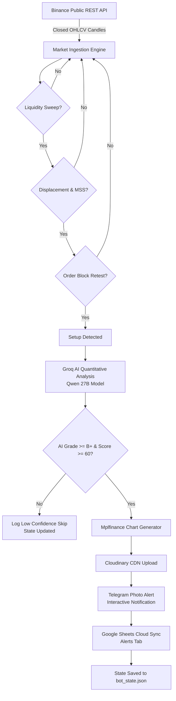

# 🚀 Institutional Crypto Liquidity Sweep & Order Block (SMC) AI Trading Scanner

[](https://www.python.org/)
[](https://binance.com)
[](https://groq.com)
[](https://telegram.org)
[](https://docs.google.com/spreadsheets/)
[](https://cloudinary.com)
[](https://docker.com)
[](LICENSE)

> **24/7 Autonomous Institutional Crypto Market Scanner** jo Smart Money Concepts (ICT / SMC) par kaam karta hai: **Liquidity Sweep (BSL/SSL) ➔ Displacement / Market Structure Shift (MSS) ➔ Order Block (OB) Retest**. Isme **Groq AI (Qwen 27B)** institutional trade scoring, **Mplfinance + Cloudinary** automatic high-res candlestick chart alerts, **Interactive Telegram Bot** aur **Live Google Sheets Sync** shaamil hain.

---

## 📑 Table of Contents (Index)

1. [Overview & Strategy (Kiya aur Kaise?)](#-overview--strategy)
2. [Key Features](#-key-features)
3. [Architecture & Workflow](#-architecture--workflow)
4. [Project Structure](#-project-structure)
5. [Telegram Bot Interactive Commands](#-telegram-bot-interactive-commands)
6. [Prerequisites & API Setup](#-prerequisites--api-setup)
7. [Environment Variables (.env)](#-environment-variables-env)
8. [Deployment Options](#-deployment-options)
   - [Option 1: Docker & Docker Compose (Recommended)](#option-1-docker--docker-compose-recommended)
   - [Option 2: Linux VPS via Systemd & deploy.sh](#option-2-linux-vps-via-systemd--deploysh)
   - [Option 3: Cloud PaaS (Railway / Render / Fly.io)](#option-3-cloud-paas-railway--render--flyio)
   - [Option 4: Local Machine (Windows / Mac / Linux)](#option-4-local-development)
9. [Verification & Diagnostic Tests](#-verification--diagnostic-tests)
10. [Troubleshooting & FAQs](#-troubleshooting--faqs)
11. [Disclaimer](#-disclaimer)

---

## 🧠 Overview & Strategy

Yeh bot crypto markets (Binance Spot) ko multi-pair aur multi-timeframe par 24/7 scan karta hai aur institutional Smart Money Concepts (SMC) setups dhoondhta hai:

```
[1. Liquidity Pool Identified]  ->  Swing High / Swing Low (Fractal Swings)
                │
                ▼
[2. Liquidity Sweep]            ->  Price wicks beyond the swing level to grab stop-losses,
                                    then rapidly reclaims inside the level.
                │
                ▼
[3. Displacement & MSS]         ->  Aggressive momentum candle (Body >= 1.2x ATR) breaks
                                    opposing market structure (Market Structure Shift).
                │
                ▼
[4. Order Block Formed]         ->  Origin candle of displacement is marked as the Order Block.
                │
                ▼
[5. Retest / Mitigation]        ->  Price pulls back and taps into the Order Block zone.
                │
                ▼
[6. Groq AI Quantitative Pass]  ->  Qwen 27B assesses trade probability, trend regime,
                                    confidence score (0-100), and assigns Grade A/B/C.
                │
                ▼
[7. Visual Chart + Cloud Alert] ->  Candlestick chart generated with PD-OHLC levels & OB,
                                    uploaded to Cloudinary, and sent to Telegram & Google Sheets.
```

---

## ✨ Key Features

- **🌐 Zero Binance API Key Needed**: Public market data endpoints se real-time closed klines fetch karta hai. Public mirrors (`data-api.binance.vision`, `api1`, `api2`, `api3`) ke saath auto-failover mechanism enabled hai.
- **⚡ Multi-Pair & Multi-Timeframe**: Default `ETHUSDT`, `SOLUSDT`, `XRPUSDT`, `BTCUSDT`, `DOGEUSDT`, `PAXGUSDT`, `XAUTUSDT` across `15m`, `5m`, `1h`, `4h`, `1m`.
- **🤖 Groq AI Quantitative Analyst (Qwen 27B)**: Har setup par real institutional grade validation:
  - **Trade Pick**: `YES - TAKE TRADE` ya `NO - SKIP TRADE`
  - **Setup Grade**: `Grade A` (High Probability), `Grade B`, `Grade C` (Low Confidence filter auto-skip)
  - **Market Regime**: Trending vs Choppy / Range-bound
  - **Dynamic Invalidation & Targets**: Reference Entry, Stop-Loss (ATR buffer) aur 2.0+ Risk-Reward ratio.
- **📊 Automatic Chart Generation**: `mplfinance` ke through live candlestick chart draw hota hai jisme **PDH (Previous Day High), PDL (Low), PDO (Open), PDC (Close)**, Swept Level aur Order Block highlight hote hain.
- **☁️ Cloudinary Hosting**: Chart images instantly Cloudinary CDN par upload hoti hain aur Telegram me direct high-resolution photo alerts ke roop me aati hain.
- **💬 Interactive Telegram Bot**: 24/7 background listener thread command aur natural Hindi/English input accept karta hai (jaise `chart btc`, `kya kar rahe ho`, `start`, `end`).
- **📈 Google Sheets Cloud Logging**: Automatic synchronization with 3 sheets:
  - `Alerts`: Confirmed setups with entry, SL, TP, RR aur AI insight.
  - `Daily Summary`: Har din rollover par comprehensive analytics.
  - `Scan Log`: Heartbeat logging every cycle.
- **🛡️ 24/7 Crash-Proof Resilience**: Har network call wrapped hai, exponential backoff, graceful shutdown (`SIGINT`/`SIGTERM`), aur deduplication state `bot_state.json` me persist hoti hai.

---

## 🏗️ Architecture & Workflow



---

## 📁 Project Structure

```bash
trade/
├── trader_bot.py         # Main application: Scanner, SMC Strategy, AI Engine, Telegram Bot
├── requirements.txt      # Python package dependencies
├── .env.example          # Template with all environment variables & explanations
├── .gitignore            # Git rules preventing secrets from leaking
├── Dockerfile            # Production Docker container image definition
├── docker-compose.yml    # One-command container deployment orchestration
├── .dockerignore         # Excludes local environments & secrets from Docker image
├── Procfile              # PaaS process file (Railway, Render, Fly.io, Heroku)
├── runtime.txt           # Declares Python 3.11.9 runtime for PaaS
├── trader-bot.service    # Linux Systemd unit file for 24/7 VPS daemon
├── deploy.sh             # Automation shell script for Linux VPS setup and control
├── bot_state.json        # Persistent bot state & deduplication (created at runtime)
├── trader_bot.log        # Rotating log file (created at runtime)
└── README.md             # Complete institutional project documentation
```

---

## 💬 Telegram Bot Interactive Commands

Aap apne Telegram chat se bot ko direct control aur query kar sakte hain. Bot slash commands aur natural language dono samajhta hai:

| Command / Message | Hindi / English Query | Description |
|---|---|---|
| `/charts` ya `chart image` | `chart dikhao`, `all charts` | Sabhi monitored pairs ke live candlestick charts with **PD-OHLC** levels & Groq AI suggestions send karta hai. |
| `chart <symbol>` | `chart btc`, `chart eth`, `chart sol` | Specific crypto pair ka single detailed chart image generate karke bhejta hai. |
| `what are doing` | `kya kar rahe ho`, `report` | Detailed bot activity report, monitored levels, open market bias, aur real-time state deta hai. |
| `end` ya `/end` | `analysis band karo`, `pause` | 24/7 background scanning aur alerts ko pause (band) kar deta hai. |
| `start` ya `/start` | `analysis shuru karo`, `resume` | Scanning wapas resume karta hai aur live market data fetch karta hai. |
| `/scan` ya `scan` | `scan now`, `check market` | Instant on-demand sweep & Order Block scan run karta hai. |
| `/status` | `bot status`, `status` | Active pairs, timeframes, scan cycle interval aur Google Sheet link dikhata hai. |
| `/exit` ya `shutdown` | `kill`, `exit` | Bot process ko completely and safely stop karta hai. |
| `/help` | `help`, `commands` | Available commands ki list show karta hai. |

---

## 🔑 Prerequisites & API Setup

### 1. Telegram Bot Token & Chat ID
1. Telegram par **[@BotFather](https://t.me/BotFather)** open karein aur `/newbot` send karein.
2. Bot ka name aur username choose karein. Aapko ek **API Token** milega (e.g. `123456789:ABCdefGHI...`).
3. Apne naye bot ko search karke **Start** button press karein ya koi message send karein.
4. Apna Chat ID nikalne ke liye Telegram par **[@userinfobot](https://t.me/userinfobot)** ko start karein. Woh aapki `Id` batayega (e.g. `6459170074`).
5. Inhe `.env` me set karein:
   ```env
   TELEGRAM_BOT_TOKEN=your_telegram_bot_token_here
   TELEGRAM_CHAT_ID=your_telegram_chat_id_here
   ```

### 2. Groq AI API Key (Free & Ultra Fast)
1. Visit [Groq Console](https://console.groq.com/keys) aur free account banayein.
2. **Create API Key** par click karke key copy karein (`gsk_...`).
3. `.env` me add karein:
   ```env
   GROQ_API_KEY=gsk_your_groq_api_key_here
   GROQ_MODEL=qwen/qwen3.8-27b
   ```

### 3. Cloudinary (Free Chart Image Hosting)
1. Free account banayein [Cloudinary](https://cloudinary.com).
2. Dashboard se **Cloud Name**, **API Key**, aur **API Secret** copy karein:
   ```env
   CLOUDINARY_CLOUD_NAME=your_cloud_name
   CLOUDINARY_API_KEY=your_api_key
   CLOUDINARY_API_SECRET=your_api_secret
   ```

### 4. Google Sheets Cloud Sync
1. [Google Cloud Console](https://console.cloud.google.com/) me ek project banayein.
2. **Google Sheets API** aur **Google Drive API** ko enable karein.
3. **IAM & Admin ➔ Service Accounts** me jakar ek Service Account banayein.
4. **Keys ➔ Add Key ➔ Create new key (JSON)** download karein.
5. Google Drive me ek naya Google Sheet banayein jiska naam rakhein: `Crypto_Liquidity_Signals`.
6. **Share** button par click karke apne Service Account ki email address (e.g. `xyz@project.iam.gserviceaccount.com`) ko **Editor** access dein.
7. **Best Practice for Cloud/Docker**: Service account JSON file ke content ko `.env` me direct paste karein:
   ```env
   GOOGLE_CREDENTIALS_JSON='{"type":"service_account","project_id":"...","private_key":"..."}'
   GOOGLE_SHEET_NAME=Crypto_Liquidity_Signals
   ```

---

## ⚙️ Environment Variables (.env)

| Variable | Required | Default | Description |
|---|---|---|---|
| `TELEGRAM_BOT_TOKEN` | Yes | - | Telegram Bot API token from @BotFather |
| `TELEGRAM_CHAT_ID` | Yes | - | User / Channel Chat ID for alerts |
| `SEND_STARTUP_MESSAGE`| No | `true` | Send notification on Telegram when bot starts |
| `GROQ_API_KEY` | Recommended | - | Groq Cloud API Key for AI quantitative trade scoring |
| `GROQ_MODEL` | No | `qwen/qwen3.8-27b` | Groq AI model name |
| `CLOUDINARY_CLOUD_NAME`| Optional | - | Cloudinary cloud name for chart image CDN |
| `CLOUDINARY_API_KEY` | Optional | - | Cloudinary API key |
| `CLOUDINARY_API_SECRET` | Optional | - | Cloudinary API secret |
| `GOOGLE_CREDENTIALS_JSON`| Optional | - | Raw JSON string of Google Service Account (Recommended for Docker/Cloud) |
| `GOOGLE_CREDENTIALS_FILE`| Optional | `credentials.json`| Fallback local filepath for Google Service Account |
| `GOOGLE_SHEET_ID` | Optional | - | ID from Google Sheet URL |
| `GOOGLE_SHEET_NAME` | Optional | `Crypto_Liquidity_Signals` | Google Sheet document title |
| `LOG_EVERY_CYCLE` | No | `true` | Log cycle heartbeat row into "Scan Log" sheet |
| `SYMBOLS` | No | `ETHUSDT,SOLUSDT,...` | Comma-separated Binance spot trading pairs |
| `TIMEFRAMES` | No | `15m, 5m, 1h, 4h, 1m` | Active timeframes to monitor |
| `SCAN_INTERVAL_SECONDS`| No | `60` | Loop interval between scan cycles |
| `TIMEZONE` | No | `UTC` | IANA Timezone string (e.g. `Asia/Kolkata`, `UTC`) |

---

## 🚀 Deployment Options

### Option 1: Docker & Docker Compose (Recommended)

Docker deployment application ko isolated container me run karta hai jisse OS dependencies ya python conflicts nahi aate.

1. **Repository clone karein & .env setup karein:**
   ```bash
   git clone <your-repo-url>
   cd trade
   cp .env.example .env
   nano .env  # Apne real API keys add karein
   ```

2. **Container build & start karein:**
   ```bash
   docker compose up -d --build
   ```

3. **Live logs dekhein:**
   ```bash
   docker compose logs -f
   ```

4. **Container stop / restart:**
   ```bash
   docker compose restart
   docker compose down
   ```

---

### Option 2: Linux VPS via Systemd & deploy.sh

Agar aap **Ubuntu / Debian VPS** (AWS EC2, DigitalOcean Droplet, Hetzner, Linode) use kar rahe hain, toh included `deploy.sh` script poora setup automatically kar deta hai:

1. **VPS par repo clone karein:**
   ```bash
   git clone <your-repo-url> /root/trade
   cd /root/trade
   ```

2. **Setup script run karein:**
   ```bash
   chmod +x deploy.sh
   ./deploy.sh setup
   ```
   *(Yeh Python, dependencies, virtual environment aur systemd service automate kar dega)*

3. **Apna `.env` configure karein:**
   ```bash
   nano .env
   ```

4. **Connectivity verify karein:**
   ```bash
   ./deploy.sh test
   ```

5. **24/7 background service start karein:**
   ```bash
   ./deploy.sh start
   ```

6. **Useful Management Commands:**
   ```bash
   ./deploy.sh status   # Check status
   ./deploy.sh logs     # Stream real-time logs
   ./deploy.sh restart  # Restart service
   ./deploy.sh stop     # Stop service
   ```

---

### Option 3: Cloud PaaS (Railway / Render / Fly.io)

Repository me already `Procfile` aur `runtime.txt` shaamil hain:

1. **Railway Deployment:**
   - [Railway.app](https://railway.app) par Login karein aur **New Project ➔ Deploy from GitHub repo** select karein.
   - **Variables** tab me apne `.env` variables paste karein.
   - Railway `Procfile` ke `worker` command ko automatically detect karke background me run kar dega.

2. **Render Deployment:**
   - [Render.com](https://render.com) par **New ➔ Background Worker** select karein.
   - GitHub repo connect karein.
   - Build Command: `pip install -r requirements.txt`
   - Start Command: `python trader_bot.py`
   - Environment Variables me `.env` keys paste karein.

---

### Option 4: Local Development

Agar aap local machine par test ya run karna chahte hain:

```bash
# 1. Virtual environment create karein
python -m venv venv

# 2. Virtual environment activate karein
# Windows:
venv\Scripts\activate
# Mac / Linux:
source venv/bin/activate

# 3. Dependencies install karein
pip install -r requirements.txt

# 4. .env file create karein aur keys dalein
copy .env.example .env

# 5. Connection test run karein
python trader_bot.py --test

# 6. Bot run karein (24/7 Mode)
python trader_bot.py

# Ya single cycle scan ke liye:
python trader_bot.py --once
```

---

## 🔍 Verification & Diagnostic Tests

Har deployment se pehle bot me built-in comprehensive diagnostic tool hai jo har service ko test karta hai:

```bash
python trader_bot.py --test
```

**Output Example:**
```text
1) Binance public API ...
   OK - ETHUSDT price = 2,414.63
2) Telegram ...
   OK - check your Telegram chat
3) Google Sheets ...
   OK - connected and appended to 'Scan Log' via .env secret (GOOGLE_CREDENTIALS_JSON)
4) Groq AI API ...
   OK - Model 'qwen/qwen3.8-27b' connected successfully (JSON mode: {"status": "READY", "model": "qwen"})
5) Cloudinary & mplfinance ...
   OK - mplfinance loaded successfully
   OK - Cloudinary connected successfully (status: ok)
```

---

## 🛠️ Troubleshooting & FAQs

### Q1: Binance request me `451` ya `403` error aata hai?
> **Answer**: Kuch cloud providers (jaise US-based AWS/DigitalOcean IPs) par Binance block hota hai. Bot me built-in fallback mirrors (`data-api.binance.vision`, `api1`, `api2`, `api3`) automatically try hote hain. Agar zaroorat ho toh `.env` me `BINANCE_BASE_URL=https://data-api.binance.vision` set karein.

### Q2: Google Sheets par write fail ho raha hai (`PERMISSION_DENIED`)?
> **Answer**: Apne Google Sheet ke **Share** button me check karein ki Service Account ki email id ko **Editor** permissions di gayi hain ya nahi.

### Q3: Telegram photo alerts nahi aa rahe, sirf text alerts aa rahe hain?
> **Answer**: Photo alerts ke liye `CLOUDINARY_CLOUD_NAME`, `CLOUDINARY_API_KEY`, aur `CLOUDINARY_API_SECRET` ka configure hona zaroori hai. Agar Cloudinary missing hoga toh bot gracefully text alerts par fallback ho jayega.

### Q4: Bot bar-bar duplicate alert toh nahi bhejega?
> **Answer**: Nahi! Har triggered setup ka unique signature (Symbol + Timeframe + Direction + Sweep Timestamp) `bot_state.json` me store hota hai. Ek candle setup par sirf ek baar alert trigger hota hai.

---

## ⚖️ Disclaimer

> **IMPORTANT**: Yeh software sirf educational aur algorithmic research purpose ke liye develop kiya gaya hai. Isme provide kiye gaye signals aur AI analysis financial advice nahi hain. Live money risk karne se pehle paper trading aur backtesting zaroor karein. Author kisi bhi trading loss ke liye zimmedar nahi hai.
